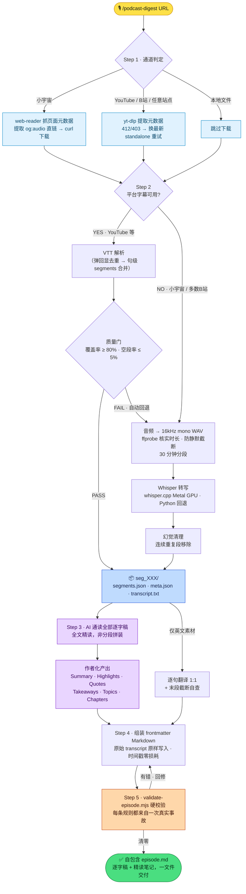
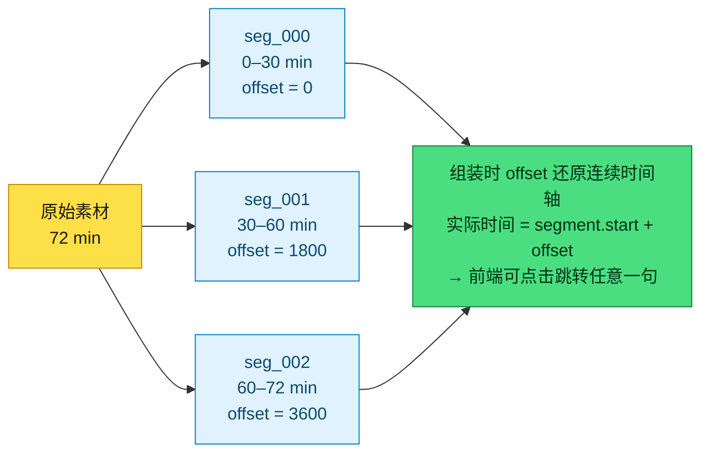

# 🎙️ podcast-digest

> **Turn any podcast / video URL into a timestamped transcript + author-grade structured digest — in one self-contained Markdown file.**
>
> 输入一个 URL，输出一份自包含的精读笔记：**精确到句的时间戳逐字稿** + **AI 通读全文后写成的** Summary / Highlights / 金句 / Takeaways / 章节地图。


一个跑在 AI Agent 里的 skill。你只说一句 `/podcast-digest <URL>`，agent 负责剩下的：下载 → 转写 → 精读 → 成稿 → 硬校验。

**支持输入**：小宇宙 · YouTube · B站（含 b23.tv 短链、充电专属视频）· 一切 yt-dlp 支持的站点 · 本地音视频文件

---

## 为什么不是"又一个视频总结工具"

市面上大多数"AI 总结视频"是这么做的：音频丢给 Whisper → 全文丢给 LLM → "总结如下"。三个坑它全踩了，本 skill 逐一给了解法：

| 常见问题 | podcast-digest 的解法 |
|---|---|
| **长播客塞不进 context window** | 30 分钟分段 + offset 时间系统，理论上支持任意时长 |
| **Whisper 幻觉 / 平台字幕质量参差** | 平台字幕优先 + 质量门 + 幻觉清理，三层防线自动择路 |
| **摘要是"分段摘要拼装"的流水账** | 强制全文精读后作者化产出——token 不是 concern |
| **时间戳经过 LLM 就失真** | transcript 原样存储、AI 不碰；LLM 只写精读层 |
| **云 ASR 要 API key、音频要上传** | 全链路本地：whisper.cpp + Metal GPU，零 API 成本，音频不出本机 |

## 工作流程



### 转写层：字幕优先，Whisper 兜底

平台字幕（快、无幻觉）永远优先，但**不盲信**——解析后过质量门（末尾覆盖率 ≥ 80%、空段率 ≤ 5%），不过关自动回退 Whisper。Whisper 路径也有自己的防线：转写前 `ffprobe` 核实音频真实时长（防 B站静默截断流），转写后清幻觉（连续重复段检测）。

### 时间系统：分段不丢时间戳



transcript 存的是平台字幕 / Whisper 的**原始 segments**（`start` / `end` / `text`），LLM 全程不碰。AI 只负责精读层，两层在最终文件里各归各位——所以时间戳永远和原音频对得上。

### 内容层：全文精读，作者化产出

Summary / Highlights / Quotes / Takeaways 必须在**通读全部逐字稿**的基础上一次产出，明确禁止"分段摘要拼装"和机械抽取。几个有观点的设计：

- **Summary 首句**必须是能独立成立的导语（谁 + 做了什么 + 核心主张），且句界干净——渲染层按句号自动分段
- **Highlights 四件套**：`title`（小标签）+ `thesis`（**一句话论点**，优先借用讲者最锐利的原话）+ `content`（100-200 字忠实展开，事实必须来自逐字稿）+ `time`（定位到音频位置）
- **Quotes** 逐字引用，Whisper 同音字错字先校正再引（小黄叔→小红书、拟据理论→拟剧理论……）
- **语言方向**：中文素材纯中文输出；英文素材全字段中英成对 + transcript 逐句 1:1 翻译（严格不跨段吸收，防时间戳错位）

## 输出格式

一个自包含的 frontmatter-only Markdown（`templates/episode.md` 是完整模板）：

```yaml
---
title: "..."
podcast: "..."
date: "2026-04-23"
duration: "91 min"
language: en
summary: "..."            # 首句 = 可独立成立的导语
summaryZh: "..."          # 仅英文素材
highlights:
  - title: "..."
    thesis: "一句话论点，讲者最锐利的原话优先"
    content: "100-200 字忠实展开"
    time: "07:38"
quotes:
  - speaker: "..."
    text: "..."
    time: "12:05"
takeaways: [...]          # 5-7 条行动建议
topics: [...]             # 8-10 个关键词 + 一句话描述
chapters: [...]           # 章节地图
chapterDetails: [...]
transcript:               # 原始逐字稿，时间戳精确到句
  - offset: 0
    segments:
      - start: 0.0
        end: 2.5
        text: "Hello welcome to..."
        translation: "..."  # 仅英文素材，1:1 逐句翻译
---
```

因为是纯 frontmatter，下游可以按 schema 消费：静态博客（Astro content collections 实战验证）、知识库导入、RAG 切片都行。

## 安装

### 依赖

| 工具 | 用途 | 安装 |
|---|---|---|
| [yt-dlp](https://github.com/yt-dlp/yt-dlp) | 元数据 / 字幕 / 音频下载 | `brew install yt-dlp` |
| ffmpeg | 音频转码 / 分段 | `brew install ffmpeg` |
| [whisper.cpp](https://github.com/ggml-org/whisper.cpp)（`whisper-cli`） | 本地转写（Metal GPU 加速） | `brew install whisper-cpp` |
| python3 | 字幕解析 / 幻觉清理脚本 | 系统自带 |
| node + js-yaml | 输出硬校验 | 本目录 `npm install` |

Whisper 模型（`ggml-large-v3`，约 3GB）首次运行自动下载到 `~/.cache/podcast-digest/models/`。没有 whisper.cpp 时自动回退 Python `openai-whisper`。

### 安装 skill

```bash
git clone https://github.com/tobyatgithub/podcast-digest.git
cd podcast-digest && npm install   # validate 脚本的 js-yaml 依赖

# Claude Code
cp -r . ~/.claude/skills/podcast-digest

# ZCode
cp -r . ~/.agents/skills/podcast-digest
```

### 用法

对 agent 说：

```
/podcast-digest https://www.bilibili.com/video/BVxxxx
/podcast-digest https://www.xiaoyuzhoufm.com/episode/xxxxx --clip 10
```

`--clip N` 只处理前 N 分钟，适合快速试跑。

## 这个 skill 是被事故喂大的

`scripts/validate-episode.mjs` 里每条规则都对应一次真实生产事故，行内注释就是事故现场：

- **B站静默截断**：免 cookie 只拿到标称 1153s 中的 550s，全程零报错 → 铁律：下载完必须 `ffprobe` 核实时长
- **yt-dlp 时效性**：2026.03 版被 B站 412 拒绝、2026.07 版正常 → 报 412/403 就拉 GitHub 最新 standalone
- **并发踩踏**：固定路径指针导致两个任务互写对方的 `segments.json` → 唯一命名 workdir
- **翻译静默截断**：末段截断 60% 仍能骗过"非空"检查，并传导进 summary/quotes → 严格 1:1 + 中英字数比值启发式告警
- **YAML 数组吞并**：漏写一个 `transcript:` 键行，全部 transcript 被 YAML 静默并进 `chapterDetails`，直到 build 才炸 → 结构校验专抓异类键
- **offset 时间数学**：绝对时间戳 + 非零 offset 导致前端时间全部翻倍 → 校验直接判死

## 仓库结构

```
podcast-digest/
├── SKILL.md                      # skill 主文件：完整流程 + 战术知识（agent 读这份）
├── scripts/
│   ├── transcribe.sh             # Whisper 转写（whisper.cpp Metal ⇄ Python 自动择路）
│   ├── parse_subtitles.py        # VTT → segments.json + 质量门 + 30min 分段
│   ├── clean_hallucination.py    # Whisper 幻觉清理（连续重复段）
│   └── validate-episode.mjs      # 输出硬校验（事故驱动规则集）
├── templates/
│   └── episode.md                # 输出 frontmatter 完整模板
└── package.json
```

## FAQ

**需要任何 API key 吗？** 不需要。ASR 本地跑 whisper.cpp，下载靠 yt-dlp，内容生成用 agent 自身的模型。

**只支持 macOS 吗？** 实战验证在 macOS（whisper.cpp + Metal，约 1-3x 实时）。Linux / Windows 理论可用（whisper.cpp 有对应后端），未验证。

**一期 60 分钟播客要跑多久？** 有平台字幕时几分钟（跳过转写）；走 Whisper 路径转写约 20-60 分钟（Metal），其余步骤取决于 agent 速度。

**中文内容效果如何？** 中文是第一公民：小宇宙 / B站全程中文输出，精读、金句校正都按中文语感打磨。

## License

MIT © 2026 Toby ([@TobyAtLarge](https://x.com/TobyAtLarge)) — built and battle-tested in a daily podcast close-reading workflow.
